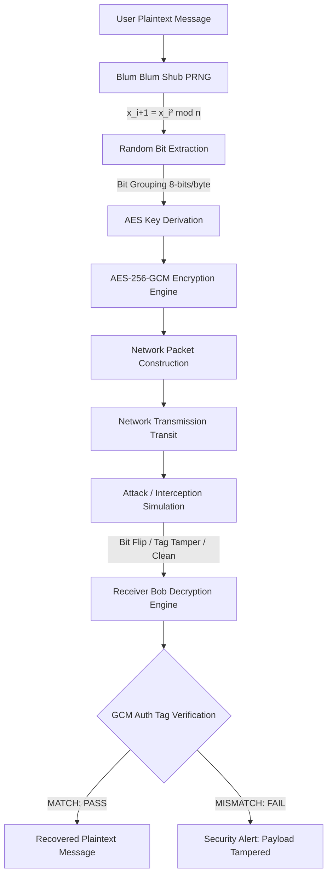

# CRYPTOVISOR
> **"See Encryption. Understand Security."**
> *Interactive Cryptographic Visualization and Attack Simulation using Blum Blum Shub*

---

## 🛡️ Project Overview

**CRYPTOVISOR** is a full-stack interactive cybersecurity research and educational visualization platform. It demonstrates how cryptographic random numbers are generated using the **Blum Blum Shub (BBS)** pseudorandom bit generator, derived into symmetric keys, utilized in **AES-256-GCM Authenticated Encryption**, transmitted over simulated networks, intercepted/tampered by adversaries, and authenticated by receivers.

Unlike traditional static web applications or simple number generators, CRYPTOVISOR exposes real-time backend cryptographic operations directly to the user interface via **WebSockets**, allowing users to observe every mathematical transformation bit-by-bit.

---

## 📐 Core Cryptographic Pipeline



---

## 🌟 Key Features

### 1. Dual Execution Modes
* **DEMO MODE (Default):** One-click execution. The engine automatically generates valid Blum primes ($p \equiv 3 \pmod 4$ and $q \equiv 3 \pmod 4$) of appropriate sizes, computes modulus $n = p \times q$, picks coprime seed $s$, generates random bitstream, derives key, encrypts, and transmits.
* **LAB MODE (Academic):** Allows entering custom primes $p$, $q$, seed $s$, and plaintext message. Features real-time primality validation, Blum condition checks ($p \equiv 3 \bmod 4$), seed coprimality testing ($\gcd(s, n) = 1$), and step-by-step mathematical calculations.

### 2. Blum Blum Shub (BBS) Engine
* Dedicated backend generator (`backend/app/bbs/`) implementing core formula:
  $$x_{i+1} = x_i^2 \bmod n$$
* Extracts Least Significant Bits (LSB) into live animated bitstreams ($10110100...$).
* **Randomness Observation Panel:** Live statistical bit distribution (0 vs 1 counts and percentages) rendered via Recharts, accompanied by cryptographic disclaimers regarding Quadratic Residuosity assumptions.

### 3. Key Derivation & AES-256-GCM
* Converts BBS bitstream into 128-bit or 256-bit keys with hex preview (`A7 3F 91 8C ...`) and Show/Hide toggle.
* Real AES-256-GCM (Galois/Counter Mode) encryption using trusted `cryptography` Python library.
* Visualizes UTF-8 byte conversion, 96-bit (12-byte) random Nonce generation, Ciphertext calculation, and 128-bit (16-byte) Authentication Tag creation.

### 4. Network Packet & Attack Simulation
* **Packet Inspector:** Formats network packet with Packet ID, Timestamp, Source (`Alice 192.168.1.10`), Destination (`Bob 192.168.1.50`), Protocol, Encrypted Payload, Nonce, and Auth Tag.
* **Interactive Attack Selector:**
  * **Clean Transmission:** Untouched transit; decryption succeeds.
  * **Passive Eavesdropping:** Attacker intercepts ciphertext; demonstrates why plaintext remains unreadable without key.
  * **Ciphertext Bit-Flipping:** Flips bits in transit; demonstrates how AES-GCM Auth Tag validation immediately rejects tampered payloads!
  * **Authentication Tag Corruption:** Alters MAC bytes; receiver rejects payload.
  * **MITM Key Mismatch:** Simulates unauthorized key injection.

### 5. Live Cyberpunk Console
* Real-time WebSocket terminal displaying raw JSON events (`BBS_STEP`, `KEY_GROUPING_STEP`, `ENCRYPTION_STARTED`, `PACKET_CREATED`, `TRANSMISSION_STEP`, `ATTACK_MODIFIED_PAYLOAD`, `DECRYPTION_COMPLETED`) as they occur on the backend.

---

## 🛠️ Technology Stack

| Layer | Technologies |
| :--- | :--- |
| **Frontend** | React 19, Vite 8, Tailwind CSS v4, Framer Motion, Lucide React, Recharts |
| **Backend** | Python 3.13, FastAPI, Uvicorn, WebSockets |
| **Cryptography** | Custom Blum Blum Shub Engine, `cryptography` (AES-256-GCM), `sympy` (Miller-Rabin Primality) |
| **Communication** | REST APIs, WebSockets (`/ws/pipeline`) |

---

## 🚀 Installation & Running

### Prerequisites
* **Python 3.10+**
* **Node.js 18+** & **npm**

### ⚡ Quick Start (Single Command)

Run both Backend and Frontend simultaneously with one command from the project root:

```bash
python run.py
# OR
npm start
# OR (Windows)
start.cmd
```

* **Frontend:** `http://localhost:5173`
* **Backend API & WS:** `http://127.0.0.1:8000`

---

### Manual Setup (Separate Terminals)

#### Step 1: Start Backend Server

```bash
# Navigate to backend directory
cd backend

# Activate virtual environment and install dependencies
python -m venv venv
venv\Scripts\activate # On Windows (or source venv/bin/activate on Linux/macOS)
pip install -r requirements.txt

# Run FastAPI backend with Uvicorn
uvicorn app.main:app --host 127.0.0.1 --port 8000 --reload
```

---

#### Step 2: Start Frontend Application

```bash
# Navigate to frontend directory
cd frontend

# Install dependencies and start Vite
npm install
npm run dev
```
Open `http://localhost:5173` in your browser.

---

## 📂 Project Structure

```
cryptovisor/
├── frontend/
│   ├── src/
│   │   ├── components/
│   │   │   ├── Navbar.jsx
│   │   │   ├── PipelineStepper.jsx
│   │   │   ├── DemoControls.jsx
│   │   │   ├── LabControls.jsx
│   │   │   ├── BbsVisualizer.jsx
│   │   │   ├── KeyGenVisualizer.jsx
│   │   │   ├── AesVisualizer.jsx
│   │   │   ├── NetworkVisualizer.jsx
│   │   │   ├── AttackSimulatorVisualizer.jsx
│   │   │   ├── DecryptionVisualizer.jsx
│   │   │   ├── SecurityReport.jsx
│   │   │   └── EventTerminal.jsx
│   │   ├── hooks/
│   │   │   └── useCryptoPipeline.js
│   │   ├── styles/
│   │   │   └── index.css
│   │   ├── App.jsx
│   │   └── main.jsx
│   ├── package.json
│   └── vite.config.js
│
├── backend/
│   ├── app/
│   │   ├── main.py
│   │   ├── bbs/
│   │   │   ├── generator.py
│   │   │   ├── prime_utils.py
│   │   │   └── validator.py
│   │   ├── crypto/
│   │   │   ├── aes_gcm.py
│   │   │   └── key_derivation.py
│   │   ├── network/
│   │   │   └── packet.py
│   │   ├── attack/
│   │   │   └── simulator.py
│   │   ├── websocket/
│   │   │   └── manager.py
│   │   └── routes/
│   │       └── pipeline.py
│   └── requirements.txt
│
├── README.md
└── .gitignore
```

---

## 🔒 Security Disclaimer

* **Educational Purpose:** CRYPTOVISOR is designed to visually demonstrate cryptographic principles. Small parameters in Lab Mode (e.g. $p = 383$, $q = 503$) are for mathematical clarity.
* **Production Standards:** In production systems, Blum Blum Shub moduli $n$ must be $\ge 2048$ to $4096$ bits to withstand integer factorization attacks (GNFS). Hardware CSPRNGs (`/dev/urandom` / `getrandom()`) are recommended for production key material.

---

## 📄 License
MIT License - Created for Cryptographic Educational Research.
